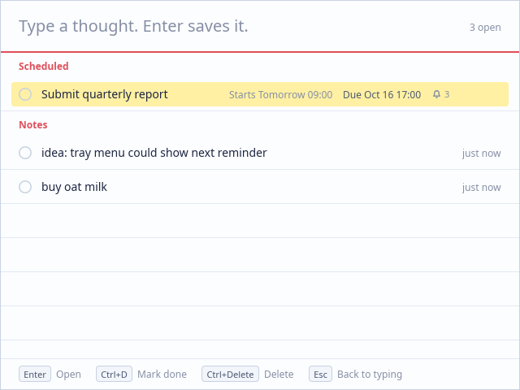
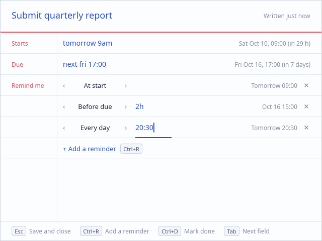
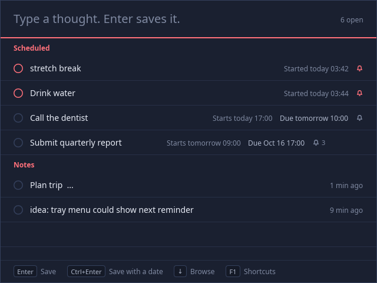

# Wisp

A small, keyboard-first place to catch ideas, memos and to-dos. Press a key from
any app, type, press Enter, and you're back to work. Written in Rust with a
[Slint](https://slint.dev) UI: one ~13 MB binary for Windows, macOS and Linux,
about 25 MB of memory while it waits, and no GPU required.



## What it does

- **One key from anywhere.** `Ctrl+Alt+Shift+N` (⌘⌥⇧N on macOS) opens Wisp with
  the cursor already in the input. Press it again, or `Esc`, to hide it. The
  window also hides when you click elsewhere (you can turn that off).
- **Type and go.** `Enter` saves the note. `Shift+Enter` adds a line. What you
  type also filters your notes, so related ones show up as you write.
- **Dates and reminders.** `Ctrl+Enter` saves and opens the note's details, where
  you can type a start and a due time in plain words ("tomorrow 9am", "fri 17:00",
  "+30m", "明天下午3点") and add reminders:
  - at the start, *N* minutes before or after the start
  - *N* minutes before the due time, or at the due time
  - every day from the start until the note is done (at the start's time of day
    or a time you pick)
- **Done means archived.** `Ctrl+D` marks a note done and moves it to the archive
  (`Ctrl+2`). Nothing is deleted unless you ask, and `Ctrl+Z` undoes the last
  change.
- **Lives in the tray** and starts with the computer (switchable in Settings).
- **Every action has a key**, and every shortcut can be changed in Settings
  (`Ctrl+,`): select a row, press `Enter`, press the new combination. Any
  combination of Ctrl, Alt, Shift and Super/Win/⌘ works; clashes are caught.
- Light and dark themes, following the system by default.

| Editing a note | Dark |
| --- | --- |
|  |  |

## Keys

Press `F1` in the app for the full list, which shows your own shortcuts.

| Where | Key | Does |
| --- | --- | --- |
| Anywhere | `Ctrl+Alt+Shift+N` | Open or hide Wisp |
| Writing | `Enter` / `Shift+Enter` | Save the note / new line |
| | `Ctrl+Enter` | Save, then add dates and reminders |
| | `Esc` | Hide (the text you typed stays for next time) |
| Your notes | `↓` `↑` `Tab` | Move through the list (`Esc` returns to typing) |
| | `Enter` or `Ctrl+E` | Open the selected note |
| | `Ctrl+D` | Mark done, or bring back from the archive |
| | `Ctrl+Delete` | Delete |
| | `Ctrl+Z` | Undo |
| | `Ctrl+1` / `Ctrl+2` | Open notes / done notes |
| Editing | `Tab` / `Shift+Tab` | Next / previous field |
| | `Esc`, or `Enter` in a date field | Save and close |
| | `Ctrl+R` | Add a reminder |
| | `←` `→` on a reminder | Change its type (`Delete` removes it) |
| Wisp | `Ctrl+,` / `F1` / `Ctrl+Q` | Settings / shortcuts / quit |

On macOS, `Ctrl` in this table is ⌘.

### Dates you can type

`today`, `tonight`, `tomorrow 9am`, `fri`, `next mon 14:00`, `17:00` (the next
time the clock shows it), `+30m`, `in 2 hours`, `+3d`, `10-20`, `oct 20 7pm`,
`2026-12-24 18:00`, and Chinese: `明天`, `后天上午10点半`, `下周一 9:00`,
`周五晚上8点`, `10月20日`, `30分钟后`. Without a time, a start means 09:00 and a
due date 18:00. The field shows how it was read before you save.

## Build and run

You need a recent stable Rust (`rustup update`).

- **Linux**: `pkg-config` and the fontconfig headers
  (`sudo apt install pkg-config libfontconfig1-dev`, or `fontconfig-devel` on Fedora).
- **macOS**: the Xcode command-line tools.
- **Windows**: the MSVC toolchain (Visual Studio Build Tools).

```sh
cargo build --release
./target/release/wisp          # Windows: target\release\wisp.exe
cargo test                     # date parsing, reminders, shortcuts, storage
```

The first start of a release build registers Wisp to start with the computer
(with `--hidden`, so it waits in the tray). Debug builds never do this on their own.

### Command line

```
wisp            open Wisp, starting it if needed
wisp --hidden   start in the tray without opening the window
wisp --toggle   open or hide the running Wisp
wisp --quit     quit the running Wisp
```

Only one Wisp runs per data folder; later launches pass their command to it.

## Where things are kept

Two JSON files, written atomically on every change:

| | |
| --- | --- |
| Windows | `%APPDATA%\Wisp\` |
| macOS | `~/Library/Application Support/Wisp/` |
| Linux | `~/.local/share/Wisp/` |

`notes.json` holds the notes and `settings.json` the settings. If `notes.json`
can't be read, it's moved aside (never overwritten) and Wisp says so.

**Portable mode:** create a folder named `wisp-data` next to the executable and
everything is stored there instead (start-with-computer stays off). The
`WISP_HOME` environment variable also overrides the location.

## Platform notes

- **Linux, X11**: everything works as described.
- **Linux, Wayland**: Wisp runs through XWayland. Wayland doesn't let apps grab
  keys system-wide, so the summon key only works while an X11 window has focus.
  Bind `wisp --toggle` to a key in your desktop's keyboard settings instead.
- **Tray on Linux** uses StatusNotifierItem: KDE, Xfce, Cinnamon and others show
  it; GNOME needs the *AppIndicator and KStatusNotifierItem Support* extension.
  Without a tray Wisp still runs; use the summon key or `wisp --quit`.
- **Notifications**: reminders use the system's notifications. If none are
  available, Wisp opens its own window instead, so a reminder is never silent.
- **macOS**: Wisp hides its Dock icon and lives in the menu bar. Shortcuts with
  ⌥ (Option) record the character Option produces, so prefer ⌘ or ⌃ combinations.
- `WISP_DEBUG=1` prints window and focus events to stderr.

## Project layout

```
ui/app.slint      the whole UI: list, editor, settings, help, tray menu
src/main.rs       start-up: single instance, hotkey, tray, timers
src/app.rs        the controller: keys, list, editor, settings, undo, reminders
src/model.rs      notes, reminder rules and the JSON store
src/dates.rs      date/time parsing and labels
src/shortcuts.rs  key combinations ↔ text ↔ system hotkeys
src/config.rs     settings and default shortcuts
src/platform.rs   data folder, autostart, notifications, single instance
src/icon.rs       the app icon, drawn in code
```
