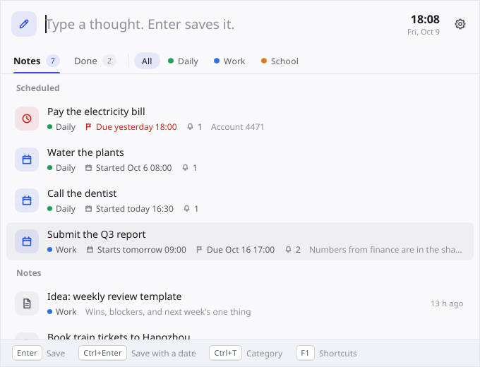
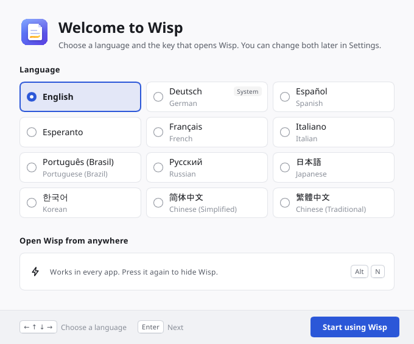
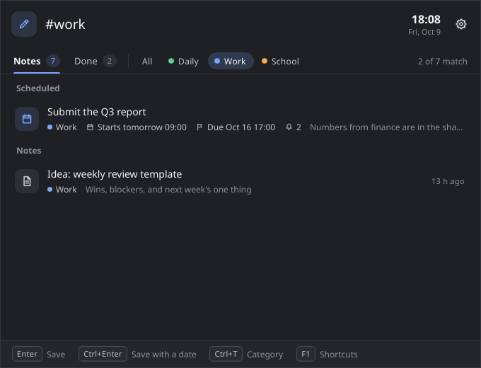
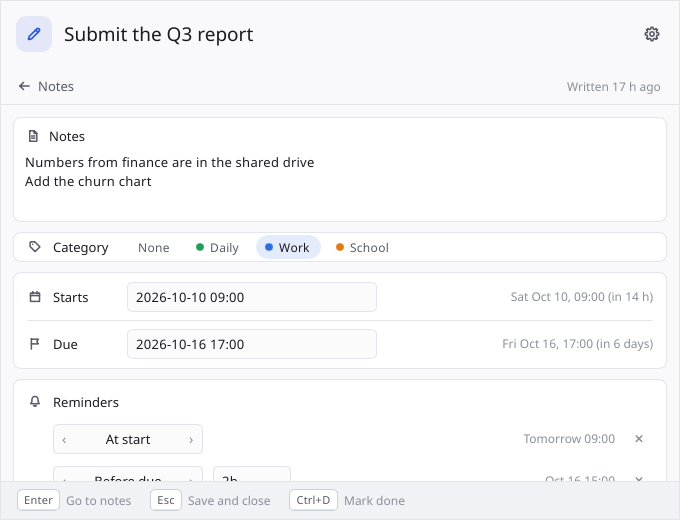
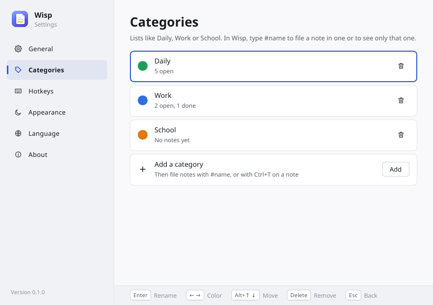
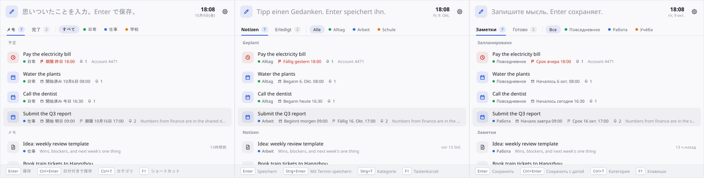

# Wisp user guide

Wisp is a small window for catching ideas, memos and to-dos without leaving what
you're doing. Press a key from any app, type, press Enter, and you're back.

- [Getting started](#getting-started)
- [Writing notes](#writing-notes)
- [The list](#the-list)
- [Categories](#categories)
- [Editing a note](#editing-a-note)
- [Reminders](#reminders)
- [Done, delete and undo](#done-delete-and-undo)
- [Settings](#settings)
- [Languages](#languages)
- [Where your notes are kept](#where-your-notes-are-kept)
- [Command line](#command-line)
- [Troubleshooting](#troubleshooting)

The keys below are the defaults; you can change them in Settings. On macOS,
`Ctrl` in this guide means ⌘. The [keyboard reference](keyboard.md) lists every key.

## Getting started

Download Wisp from the
[latest release](https://github.com/shiraha721/Wisp/releases/latest), or build
it from source (see [Development](development.md)).

**Windows.** Unzip `wisp-…-windows-x64.zip` into a folder of its own, for
example `D:\Apps\Wisp\`, and start `Wisp.exe`. It creates a `data` folder next
to itself for your notes, adds itself to the programs that start with Windows,
and waits in the system tray.

**macOS and Linux.** Unpack the `.tar.gz` for your system and start `wisp`. The
macOS programs aren't signed: allow `wisp` under System Settings → Privacy &
Security the first time (or run `xattr -d com.apple.quarantine wisp`). Notes go
to `~/Library/Application Support/Wisp` or `~/.local/share/Wisp`, unless you put
a `data` folder next to the program.

**The first start.** Wisp first asks two things: the language to show it in,
and the key that opens it. English is selected, and your system's language is
marked "System". Choosing a language switches to it right away. To use another
key than `Alt+N`, move to the key card (`Enter`) and press the combination you
want; `Backspace` goes back to `Alt+N`. Then press **Start using Wisp**, or
`Enter` until you're there. Both can be changed later in Settings.

**Opening Wisp.** Press `Alt+N` from any app (⌃⌥N on macOS). The window opens
near the top of the screen with the cursor in the box, ready to type. Press
`Alt+N` again, or `Esc`, to hide it. It also hides when you click somewhere else;
Settings → General turns that off.

If another program already uses `Alt+N`, Wisp says so and opens with
`Ctrl+Alt+Shift+N` instead. Settings → Hotkeys lets you pick any combination.

The tray icon's menu opens Wisp, opens Settings or quits Wisp. Clicking the icon
opens Wisp.

## Writing notes

Type in the box at the top and press `Enter`. The note is saved and the box is
empty again for the next one.

- The first line is the note's title. `Shift+Enter` starts another line;
  everything after the first line becomes the note's details.
- `Ctrl+Enter` saves the note and opens it, so you can give it a start time, a
  due time and reminders.
- `Esc` hides Wisp. Whatever you typed stays in the box for next time.
- `Ctrl+Z` right after saving takes the note back into the box.

What you type also filters the list below: a note shows if all your words
appear in its title or details, in any order. That way related notes turn up
while you write, and the box doubles as a search.

## The list

Wisp has two tabs: **Notes** (`Ctrl+1`) for everything open, and **Done**
(`Ctrl+2`) for what you've finished.

The Notes tab has two parts:

- **Scheduled**: notes with a start or due time. A note whose reminder just rang
  comes first, then overdue notes, then the rest by the nearest date.
- **Notes**: everything else, newest first.

The Done tab lists finished notes newest first, grouped by the day they were
done.

Each line shows the note's title and, under it, its category, start and due
times, how many reminders it has and the first line of its details. The icon on
the left tells you what kind of note it is: a page for a plain note, a calendar
for a scheduled one, a bell when a reminder has rung, a clock when it's overdue
and a check mark when it's done.

To move through the list:

| Key | Does |
| --- | --- |
| `↓` / `↑` | Next / previous note. `↑` on the first note goes back to typing. |
| `Tab` / `Shift+Tab` | Next / previous note, wrapping around at the ends. |
| `PageDown` / `PageUp` | Six notes down / up. |
| `Esc` | Back to typing (and with nothing selected, hide Wisp). |

With a note selected, `Enter` (or `Ctrl+E`) opens it, `Ctrl+D` marks it done,
`Ctrl+T` changes its category and `Ctrl+Delete` deletes it.

With the mouse: click a note to select it, double-click to open it, and click
its icon to mark it done.

## Categories

Categories sort your notes into lists such as Daily, Work or School. Wisp starts
with those three; Settings → Categories adds, renames, recolours, reorders and
removes them.

The chips next to the tabs show the categories. Click one to see only its notes;
click **All** to see everything again.

From the keyboard, categories are words that start with `#`:

- **Show one category.** Type `#work` in the box and the list shows only Work
  notes. The rest of what you type still filters as usual.
- **File a note.** `Buy paper #work` saves "Buy paper" in Work. The `#work`
  stays in the box afterwards, so the next note goes there too. Delete it to
  go back to all notes.
- **Matching is loose.** Case, spaces, `-` and `_` don't matter, and the start of
  a name is enough: `#wo` finds Work, `#side-project` finds "Side project". A
  `#` word that names no category, like "issue #42", is left alone.

`Ctrl+T` steps through the categories:

- with a note selected, it moves that note to the next category (and from the
  last one to none);
- with nothing selected, it changes the `#` word in the box;
- while editing a note, it changes that note's category.

`Ctrl+Shift+T` goes the other way.

Removing a category doesn't remove its notes; they simply have no category
afterwards. Wisp asks you to press `Delete` (or click the bin) a second time
before it removes one.

## Editing a note

Open a note with `Enter`. The editor shows:

- the **title**, at the top;
- **Notes**, the details: any number of lines;
- **Category**;
- **Starts** and **Due**, typed in plain words (see [Typing dates](dates.md));
- **Reminders**.

Moving around: `Tab` and `Shift+Tab` go from field to field. `Enter` in the
title goes to the details; in the details it starts a new line; in the other
fields it saves and closes the note.

On the category row, `←` and `→` (or `Space`) change the category, `Delete`
clears it, and typing a letter jumps to the next category starting with it.

**Closing.** `Esc` saves and closes. If something can't be read, such as a date
Wisp doesn't understand, the first `Esc` stops and says what's wrong. Fix it, or
press `Esc` again: Wisp saves everything else and keeps the old value of what it
couldn't read. You never get stuck in the editor.

**Dates.** Next to each date field, Wisp shows how it read what you typed, for
example "Fri Oct 9, 17:00 (in 2 days)". A start date without a time means 09:00;
a due date without a time means 18:00.

Clearing both the title and the details deletes the note when you close it.
`Ctrl+Z` brings it back.

## Reminders

Reminders ring relative to a note's start or due time, so a note needs one of
those first. The first time you give a note a date, Wisp adds a reminder for
you: at the start, or an hour before the due time if there's no start.

`Ctrl+R` adds another reminder. Each one is one of these:

| Kind | Rings |
| --- | --- |
| At start | when the note starts |
| Before start | the given time before the start, e.g. `15m` |
| After start | the given time after the start |
| Before due | the given time before the due time, e.g. `1h` |
| At due | at the due time |
| Every day | every day from the start until the note is done, at the start's time of day or at a time you type, e.g. `09:00` |

Times are written like `15m`, `2h`, `1h30m` or `1d`. Words work too, in English
and in the language Wisp is shown in: `15 min`, `2 hours`, `2 Stunden`, `2小时`.

On a reminder, `←` and `→` change its kind and `Delete` removes it.
`Ctrl+Shift+R` removes the reminder you're on, or the last one, from anywhere in
the note.

**When a reminder rings** you get a system notification (from "Wisp" on
Windows), a line at the bottom of Wisp's window, and the note moves to the top
of the list with a red bell. Opening the note clears the bell. If you'd like the
window itself to appear, switch on Settings → General → "Open Wisp when a
reminder rings". On a computer without a notification service, Wisp always
opens its window instead, so a reminder is never silent.

If your computer was off or asleep when a reminder was due, Wisp rings it when
it's back, unless the moment was more than six hours ago. A daily reminder
carries on the next day either way.

A reminder that has nothing to follow, such as "Before due" on a note with no
due time, is left out when the note is saved, and Wisp tells you so.

## Done, delete and undo

`Ctrl+D` marks the selected note done. It moves to the Done tab, where it stays;
Wisp never throws done notes away. `Ctrl+D` on a done note brings it back.

`Ctrl+Delete` deletes a note.

`Ctrl+Z` undoes the last change to your notes: saving a new one, editing, marking
done, changing a category or deleting. Wisp remembers the last 50 changes. When
you've just been typing in the box, `Ctrl+Z` undoes the typing instead.

## Settings

Open Settings with the gear button in Wisp's window, `Ctrl+,`, the tray menu, or
`wisp --settings`.

| Page | What's there |
| --- | --- |
| General | Start with the computer, hide when you click elsewhere, open Wisp when a reminder rings. |
| Categories | Your categories: rename (`Enter`), change colour (`←` `→`), move (`Alt+↑` `Alt+↓`), remove (`Delete` twice), and add new ones. |
| Hotkeys | Every key Wisp listens to. Select one, press `Enter`, then press the new combination. `Backspace` puts a key back to its default; "Reset all shortcuts" does them all. |
| Appearance | Light, dark, or following the system. |
| Language | The language Wisp is shown in. |
| About | The version, and the folder your notes are in (with a button to open it). |

Settings works from the keyboard too: `↑` and `↓` choose a page, `Enter` goes
into it, `Esc` goes back to the page list and closes the window from there. The
bar at the bottom of the window always shows the keys that work right now.

When you record a new shortcut, Wisp refuses combinations that would get in the
way of typing: every shortcut needs `Ctrl`, `Alt` or `Win`/⌃, or a function key.
A combination that's already taken by another shortcut is caught, and Wisp tells
you which one.

## Languages

Wisp speaks English, German, Spanish, Esperanto, French, Italian, Portuguese
(Brazil), Russian, Japanese, Korean, and Chinese (Simplified and Traditional).
English is the default. The first start asks which one you want, and
Settings → Language switches any time. "Match system" follows your system's
language when Wisp has it, and English otherwise.

The language also decides how dates are shown ("Fr, 9. Okt.", "10月9日(金)")
and which date words the date fields understand. English always works there, as
do Chinese, Japanese, Korean and Russian. [Typing dates](dates.md) has examples
for each language.

The categories Wisp starts with are named in the language you choose when it
first starts. Rename them any time.

## Where your notes are kept

Everything Wisp knows is in two files in its data folder:

- `notes.json`: your notes, their dates and reminders, and your categories.
- `settings.json`: your settings.

On Windows there's also `wisp.png`, the icon Windows shows on Wisp's
notifications.

Which folder that is:

1. If the `WISP_HOME` environment variable is set, that folder.
2. A `data` folder next to the program, if there is one (portable mode).
3. On Windows, Wisp creates that `data` folder on first start. If you used an
   earlier Wisp that kept notes in `%APPDATA%\Wisp`, they're copied over and the
   originals are left as they were.
4. Otherwise, or if the program's folder can't be written to (under Program
   Files, say): `%APPDATA%\Wisp`, `~/Library/Application Support/Wisp` or
   `~/.local/share/Wisp`.

Settings → About shows the folder in use and opens it.

**Backups.** Copy the data folder. Wisp writes both files whole each time (to a
temporary file first, then renamed), so a crash never leaves half a file. If
`notes.json` or `settings.json` can't be read, Wisp never writes over it: it
moves the file aside as `notes.broken-<date>.json` (or `settings.broken-…`)
and tells you. If even that fails (the file is locked, say), Wisp doesn't save
at all until you restart it.

**Moving Wisp.** Quit Wisp, move its whole folder, and start it from the new
place. If it starts with the computer, it updates that entry itself. If you
switch that off outside Wisp (in Task Manager's Startup apps, say), Wisp leaves
it off and turns off its own setting to match.

**Editing the files.** Quit Wisp first, or it may write over your changes. The
format is described in [Data files](data-format.md).

Outside its folder, Wisp writes only to the Windows registry: the
start-with-Windows entry (when switched on) and the name and icon Windows shows
on its notifications.

## Command line

| Command | Does |
| --- | --- |
| `wisp` | Opens Wisp, starting it if it isn't running. |
| `wisp --hidden` | Starts Wisp in the tray without opening the window. This is how it starts with the computer. |
| `wisp --toggle` | Opens or hides the running Wisp. |
| `wisp --settings` | Opens Settings. |
| `wisp --quit` | Quits the running Wisp. |

Only one Wisp runs per data folder; starting it again passes the command to the
one that's running.

## Troubleshooting

**The key that opens Wisp does nothing.** Another program may have claimed it
first. Wisp says so when it starts and in Settings → Hotkeys; pick another
combination there. On Linux with Wayland, apps can't listen for keys
system-wide: bind `wisp --toggle` to a key in your desktop's keyboard settings.

**There's no tray icon on Linux.** GNOME needs the *AppIndicator and
KStatusNotifierItem Support* extension. Without a tray, Wisp still runs; use its
key, or `wisp --quit` to quit.

**Reminders don't show up.** Check that your system isn't in Do Not Disturb or
Focus mode. On Windows, Wisp's notifications can be switched off under Settings
→ System → Notifications → Wisp.

**I want to start over with the settings.** Quit Wisp and delete
`settings.json` from its data folder. Your notes are untouched.

**Wisp started in the wrong language.** English is the default. Change it in
Settings → Language, or set `"language"` in `settings.json` (see
[Data files](data-format.md)).
